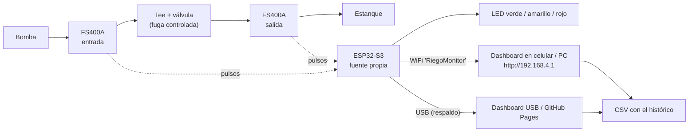

# Riego Monitor · Detector de pérdidas de agua en riego agrícola

Sistema IoT que mide el caudal al **entrar** y al **salir** de un tramo de riego con dos sensores FS400A. Una ESP32-S3 compara ambos caudales cada segundo, enciende un LED verde, amarillo o rojo según la diferencia y publica los datos por su propia red WiFi a un dashboard que se abre desde cualquier celular o PC.

TEI201 · Taller de Diseño en Ingeniería · Universidad Adolfo Ibáñez

**Integrantes:** Andrés García · Pablo Miranda · Macarena Kuperman · Mathias Kind

## Problema

En las conducciones de riego agrícola se pierde agua por roturas y uniones que filtran, y muchas veces no se detecta hasta que el daño es visible. Si el caudal que sale de un tramo es menor que el que entra, hay una pérdida en ese tramo. El sistema da una alerta temprana para inspeccionar el tramo (ODS 6, meta 6.4). Detalle del enfoque más abajo.

## Arquitectura



| Estado | Condición (promedio de 5 s) | LED |
|---|---|---|
| Sin flujo | Caudal de entrada < 0,5 L/min | Apagados |
| Normal | Diferencia < 10 % | Verde |
| Advertencia | 10 % ≤ diferencia < 25 % | Amarillo |
| Fuga | Diferencia ≥ 25 % | Rojo |

## Componentes para replicarlo

ESP32-S3 Super Mini · 2 sensores de flujo FS400A G1 (1") · 2 divisores 10 kΩ / 20 kΩ · 3 LED (verde, amarillo, rojo) con resistencia · placa perforada 5 × 7 cm · cabezales hembra · fuente 5 V · mini bomba sumergible 5 V con su propia fuente · PVC 32 mm, codos, tee y válvula de bola. Lista completa con costos (total de referencia **CLP 72.790**) en la [BOM](hardware/bom/README.md); conexiones en el [esquema](hardware/esquemas/README.md).

## Cómo usarlo

1. **Cargar el firmware:** abrir [`software/src/RiegoMonitor_WiFi/RiegoMonitor_WiFi.ino`](software/src/RiegoMonitor_WiFi/RiegoMonitor_WiFi.ino) en Arduino IDE → placa **ESP32S3 Dev Module**, **USB CDC On Boot: Enabled** → Subir. No necesita librerías externas.
2. **Alimentar** la ESP32 con su fuente (pines 5V y GND) y la bomba con la suya.
3. **Ver el dashboard:** conectarse a la red WiFi **RiegoMonitor** (clave `riego1234`) y abrir **http://192.168.4.1**.
4. **Respaldo por cable:** conectar la ESP32 por USB y abrir el [dashboard USB](docs/index.html) en Chrome/Edge (publicado en GitHub Pages: https://mkind06.github.io/sensor_fugas_TEI201-/).
5. **Guardar datos:** botón **Descargar CSV**.

Manual completo y diagnóstico: [software/docs](software/docs/README.md).

## Avance 3: entregables

| Dimensión | Contenido | Documento |
|---|---|---|
| Software | Firmware final, formato de datos, dashboard, información generada, persistencia CSV | [software/](software/README.md) |
| Hardware | Cambios v2→v3, justificación de componentes, alimentación, diseño para la reparación | [hardware/](hardware/README.md) |
| Esquemático | [Esquemático en PDF](hardware/esquemas/esquematico_v3.pdf) y coordenadas de la placa soldada | [hardware/esquemas](hardware/esquemas/README.md) |
| BOM | Componentes, cantidades y costos | [hardware/bom](hardware/bom/README.md) |
| Fotos | Banco de PVC y montaje | [hardware/fotos](hardware/fotos/README.md) |
| Diseño 3D | Caja v3 en Fusion 360 ([.f3d](diseno_3d/fusion360/caja_v3.f3d)) y STEP, ensamble con electrónica, gemelo de la demo, renders, planos PDF, visor | [diseno_3d/](diseno_3d/README.md) |
| Testing | Protocolo, resultados, fallas y validación contra el problema | [testing/](testing/README.md) |
| Iteraciones | Evolución v1 → v3 | [iteraciones/](iteraciones/README.md) |
| Presentación | Guion de la demo en vivo | [documentacion/presentacion](documentacion/presentacion/README.md) |
| Reporte | Índice del reporte final, sección por documento | [documentacion/reporte_final](documentacion/reporte_final/README.md) |
| Fuentes e IA | Librerías, código externo y uso de IA | [FUENTES.md](FUENTES.md) |

**Estado honesto:** el sensor 1 quedó sin lectura por una falla en su divisor de la placa soldada (diagnóstico en [testing](testing/resultados_avance3.md)). El sensor 2, los LED, la red WiFi y el dashboard funcionan; mientras se repara el sensor 1, los tres estados se muestran con un modo demo identificado como simulado.

## Estructura del repositorio

```text
├── README.md · FUENTES.md
├── firmware/      acceso directo al código de la ESP32 (en software/src/)
├── software/      firmware (src/), dashboards (src/web/), manual (docs/), librerías
├── hardware/      esquemas/, bom/, fotos/
├── diseno_3d/     cad/ (STEP, DXF, scripts), renders/, visor/, fusion360/, planos/
├── testing/       protocolo y resultados de Avance 3, datos/, evidencias/
├── iteraciones/   v1, v2, v3
├── documentacion/ presentación y reporte
└── docs/          dashboard publicado en GitHub Pages
```

---

## Antecedente: Avance 2 (prototipo Alpha)

El banco recircula agua por dos sensores FS400A y permite abrir una derivación entre ellos. Una ESP32-S3 Super Mini estima los caudales, compara su diferencia y activa un LED verde, amarillo o rojo. La comunicación disponible es USB serie al computador. La bomba se enciende manualmente y tiene alimentación independiente.

La demostración ya se realizó: el equipo informó que se observaron los tres estados. No se conservó el registro final. Esta entrega documenta el montaje, las mediciones disponibles, las decisiones de diseño y el concepto de encapsulado.

| Contenido de esta entrega | Documento |
|---|---|
| Montaje y alimentación | [Hardware](hardware/README.md) |
| Componentes confirmados | [BOM](hardware/bom/README.md) |
| Fotografías del montaje final y monitor web | [Evidencia fotográfica](hardware/fotos/README.md) |
| Diagrama y coordenadas de protoboards | [Circuito](hardware/esquemas/README.md) |
| Código y comunicación USB | [Software](software/README.md) |
| Instalación y operación | [Manual](software/docs/README.md) |
| Modelo STEP, plano DXF y justificación | [Encapsulado conceptual](diseno_3d/README.md) |
| Problemas, soluciones y cambios | [Iteraciones](iteraciones/README.md) |
| Mediciones y procedencia del testeo | [Testeo](testing/README.md) |
| Revisión de requisitos de la guía | [Estado de la entrega](documentacion/README.md) |
| Revisión documento por documento | [Matriz del Avance 2](documentacion/revision_avance2.md) |

## Alcance y evidencia

Se distinguen siete lecturas físicas anteriores al ajuste, registros de diagnóstico, un testeo de lógica con datos sintéticos y el resultado cualitativo comunicado por el equipo. Ninguno sustituye un registro físico continuo de cinco minutos. El STEP y el DXF son archivos de diseño conceptual; la impresión y el ensamble con componentes reales quedan por verificar.

## Problema y enfoque agrícola

El proyecto se enfoca en pérdidas de agua en conducciones de riego agrícola y su detección mediante comparación de caudal antes y después de un tramo. Sus usuarios previstos son agricultores, encargados de riego y profesionales de agronomía. La alerta permite advertir una diferencia y orientar una inspección del tramo; el Alpha no localiza el punto exacto de la fuga ni cierra el agua automáticamente.

El equipo acotó el desarrollo a un tramo agrícola con recorrido conocido para trabajar con menos ramificaciones, consumos simultáneos y variables desconocidas que las de una red urbana completa. Esta simplificación corresponde al alcance elegido, no a afirmar que todo sistema agrícola sea simple. En una aplicación real deben considerarse presión, rango de caudal, aire, sedimentos, válvulas y salidas de riego. Una salida legítima entre sensores también produce una diferencia: las salidas normales deben quedar fuera del tramo vigilado o medirse por separado.

## Objetivos de Desarrollo Sostenible

- **ODS principal: 6, Agua limpia y saneamiento; meta 6.4.** El proyecto se vincula con el uso eficiente del agua al advertir posibles pérdidas en la conducción de riego y facilitar su revisión. [Meta oficial de Naciones Unidas](https://sdgs.un.org/goals/goal6).
- **ODS complementario: 2, Hambre cero; meta 2.4.** Su aplicación prevista apoya prácticas agrícolas sostenibles mediante un mejor cuidado del agua destinada al riego. Esta relación es indirecta y no constituye evidencia de mayor producción o resiliencia de cultivos. [Meta oficial de Naciones Unidas](https://sdgs.un.org/goals/goal2).

El logro de Avance 2 es la detección y señalización en banco. Aún no se midieron ahorro de agua, rendimiento agrícola ni cambios en los indicadores oficiales de estas metas.

## Pendiente

- Reparar el divisor del sensor 1 y completar las pruebas P6 (fuga controlada) y P8 (estabilidad 5 min): ver [resultados](testing/resultados_avance3.md).
