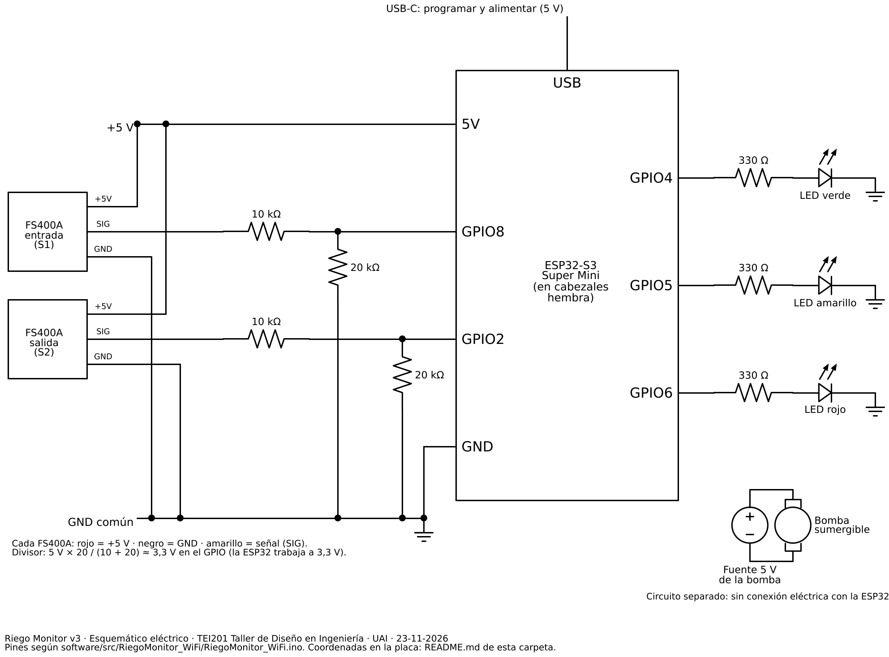
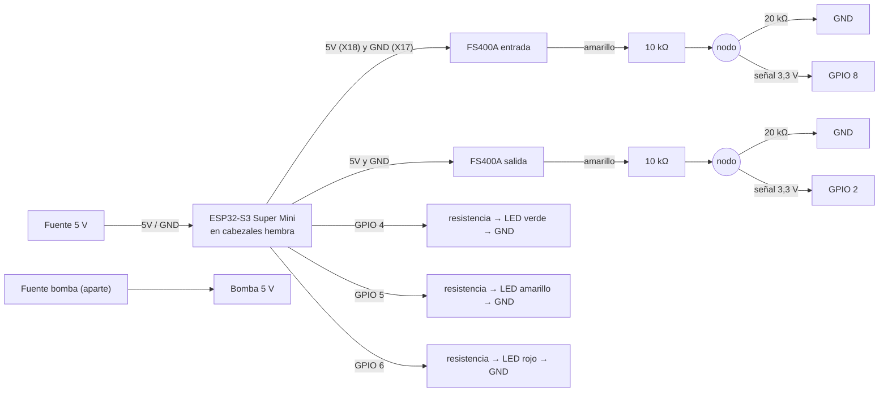
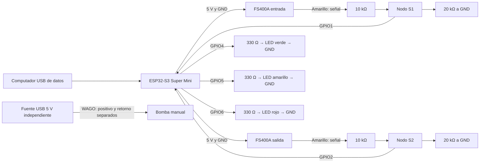
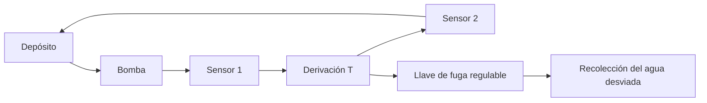

# Esquemas de Circuito - Avance 3 (placa perforada soldada)

## Esquemático

**Archivo:** [esquematico_v3.pdf](esquematico_v3.pdf) · también en [PNG](esquematico_v3.png) y [SVG](esquematico_v3.svg).

Dibujado con [schemdraw](https://schemdraw.readthedocs.io) a partir de los pines del firmware final (`RiegoMonitor_WiFi.ino`). Para regenerarlo: `pip install schemdraw matplotlib` y `python esquematico.py`.

## Esquema eléctrico

## Coordenadas en la placa perforada

Placa de 5 × 7 cm, agujeros independientes (sin pistas). Columnas A–X y filas 01–18 según la serigrafía. Componentes por la cara superior; soldaduras y cables por la inferior.

**ESP32-S3 (cabezales hembra de 9 pines):** columna R filas 10–18 y columna X filas 10–18, USB-C hacia el borde.

| Coordenada | Pin de la ESP32 | Uso |
|---|---|---|
| X18 | 5V | Alimentación de sensores (cable a B8) |
| X17 | GND | Tierra común (cable café a J15) |
| X16 | 3V3 | Sin uso |
| X10 | GPIO 8 | Señal del sensor 1 |
| R16 | GPIO 1 | Señal original del sensor 1 (en diagnóstico) |
| R15 | GPIO 2 | Señal del sensor 2 (cable naranja desde F3) |
| R13 | GPIO 4 | LED verde |
| R12 | GPIO 5 | LED amarillo |
| R11 | GPIO 6 | LED rojo |

**LED** (pata larga + en columna K, corta − en J; la columna J es la línea de tierra):

| LED | Resistencia | LED (+ / −) | Tierra |
|---|---|---|---|
| Verde | P13 → L15 (pata de P13 soldada a R13) | K15 / J15 | J15 → X17 (cable café) |
| Amarillo | P12 → L12 (pata de P12 a R12) | K12 / J12 | Cable J12 → J15 |
| Rojo | P11 → L9 (pata de P11 a R11) | K9 / J9 | Cable J9 → J12 |

**Sensores** (conector hembra de 3 pines: señal, 5 V, GND):

| | Sensor 1 | Sensor 2 |
|---|---|---|
| Conector (amarillo / rojo / negro) | B9 / B8 / B7 | B5 / B4 / B3 |
| 10 kΩ (beige) | C9 → F9 (pata de C9 a B9) | C5 → F5 (pata de C5 a B5) |
| 20 kΩ (azul) | C7 → F7 (pata de C7 a B7) | C3 → F3 (pata de C3 a B3) |
| Nodo del divisor | Puente F9 → F7 | Puente F5 → F3 |
| Señal a la ESP32 | F9 / F7 → X10 (GPIO 8) | F3 → R15 (GPIO 2) |
| 5 V | B8 → X18 (cable rojo) | B4 → B8 (cable morado) |
| GND | B7 → J9 | B3 → B7 (cable blanco) |

Columna A filas 15–18: tramo de cabezal soldado como práctica, sin conexión eléctrica.

## Errores corregidos durante el soldado

| Problema | Causa | Solución |
|---|---|---|
| El LED amarillo no encendía (el verde sí) | El puente de tierra J12–J15 hecho con una patita quedó apoyado sobre las soldaduras sin fundirse | Cable aislado J12 → J15 soldado en ambos extremos. Se confirmó antes tocando J12 y J15 con un jumper |
| El sensor 2 contaba pulsos sin agua (1.433 al manipular la bomba) | El cable de señal quedó soldado en la columna X (GPIO 12) en vez de R15 (GPIO 2): el GPIO 2 quedaba flotando y captaba ruido | Cable movido a R15 |
| La ESP32 no encendía al conectar el sensor | Contacto entre soldaduras durante el montaje; resuelto al reenchufar | Revisión de X18/X17 antes de energizar |
| El sensor 1 dejó de contar | Falla en el camino de señal B9 → 10 kΩ → F9/F7 → GPIO (el sensor 2 tampoco cuenta en ese conector) | Señal movida a GPIO 8 sin éxito; pendiente revisar continuidad con tester. Ver [testing](../../testing/resultados_avance3.md) |

---

# Esquemas de Circuito - Avance 2 (antecedente)

## Circuito eléctrico

Los negros de ambos sensores, las resistencias inferiores y los cátodos comparten GND con la ESP32. Los rojos de los sensores reciben 5 V. La bomba tiene circuito de alimentación independiente, sin mando desde la placa. El divisor nominal entrega 5×20/(10+20)=3,33 V; no se ha comprobado con multímetro.

## Coordenadas del montaje

Cada fila conecta A–E y, por separado, F–J; la ranura separa ambos grupos. Identificar GPIO por serigrafía de placa y mantener la orientación usada por el equipo.

### Protoboard negra

| Elemento | Coordenadas |
|---|---|
| GPIO4 / resistencia verde 330 Ω | A3 / D3–D7 |
| LED verde | Ánodo E7; cátodo F7 |
| GPIO5 / resistencia amarilla 330 Ω | A8 / D8–D12 |
| LED amarillo | Ánodo E12; cátodo F12 |
| GPIO6 / resistencia roja 330 Ω | A13 / D13–D17 |
| LED rojo | Ánodo E17; cátodo F17 |
| GND ESP32 | J7 |
| Puentes de retorno | I7–J12 e I12–J17 |
| GND a blanca | H7 negra → B11 blanca |

Las patas de cada LED cruzan la ranura central.

### Protoboard blanca

| Elemento | Sensor 1 | Sensor 2 |
|---|---|---|
| Señal amarilla | A3 | J3 |
| 10 kΩ | D3–D7 | G3–G7 |
| 20 kΩ | C7–C11 | H7–H11 |
| Señal a placa | B7 → GPIO1 | I7 → GPIO2 |
| Negro | A11 | J11 |
| Rojo | A15 | J15 |
| Alimentación | 5 V de placa → B15 | Puente E15–F15 |
| Retorno | GND desde negra → B11 | Puente E11–F11 |

## Recorrido hidráulico

La separación de fuentes y el filtro surgieron tras conteos espurios; el sellado de la boquilla resolvió una pérdida ajena a la derivación. Fritzing, Wokwi y planos finales no se presentan como archivos existentes: la guía exige un diagrama claro, sin imponer esos formatos.
