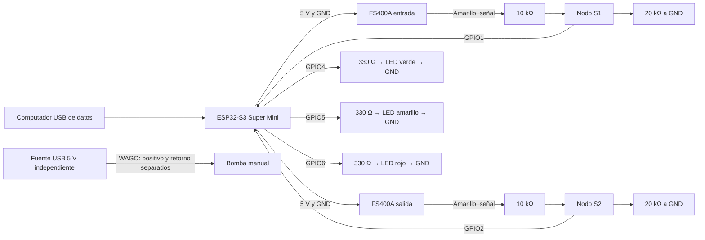
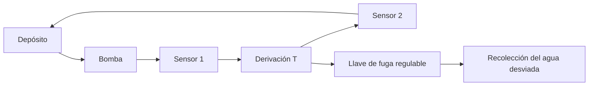

# Esquemas de Circuito - Avance 2

## Circuito eléctrico

Los negros de ambos sensores, las resistencias inferiores y los cátodos comparten GND con la ESP32. Los rojos de los sensores reciben 5 V. La bomba tiene circuito de alimentación independiente, sin mando desde la placa. El divisor nominal entrega 5×20/(10+20)=3,33 V; no se ha comprobado con multímetro.

## Coordenadas del montaje

Cada fila conecta A–E y, por separado, F–J; la ranura separa ambos grupos. Identificar GPIO por serigrafía de placa y mantener la orientación usada por el equipo.

### Protoboard negra

| Elemento | Coordenadas |
|---|---|
| GPIO4 / resistencia verde 330 Ω | A3 / D3–D7 |
| LED verde | Ánodo E7; cátodo F7 |
| GPIO5 / resistencia amarilla 330 Ω | A8 / D8–D12 |
| LED amarillo | Ánodo E12; cátodo F12 |
| GPIO6 / resistencia roja 330 Ω | A13 / D13–D17 |
| LED rojo | Ánodo E17; cátodo F17 |
| GND ESP32 | J7 |
| Puentes de retorno | I7–J12 e I12–J17 |
| GND a blanca | H7 negra → B11 blanca |

Las patas de cada LED cruzan la ranura central.

### Protoboard blanca

| Elemento | Sensor 1 | Sensor 2 |
|---|---|---|
| Señal amarilla | A3 | J3 |
| 10 kΩ | D3–D7 | G3–G7 |
| 20 kΩ | C7–C11 | H7–H11 |
| Señal a placa | B7 → GPIO1 | I7 → GPIO2 |
| Negro | A11 | J11 |
| Rojo | A15 | J15 |
| Alimentación | 5 V de placa → B15 | Puente E15–F15 |
| Retorno | GND desde negra → B11 | Puente E11–F11 |

## Recorrido hidráulico

La separación de fuentes y el filtro surgieron tras conteos espurios; el sellado de la boquilla resolvió una pérdida ajena a la derivación. Fritzing, Wokwi y planos finales no se presentan como archivos existentes: la guía exige un diagrama claro, sin imponer esos formatos.
