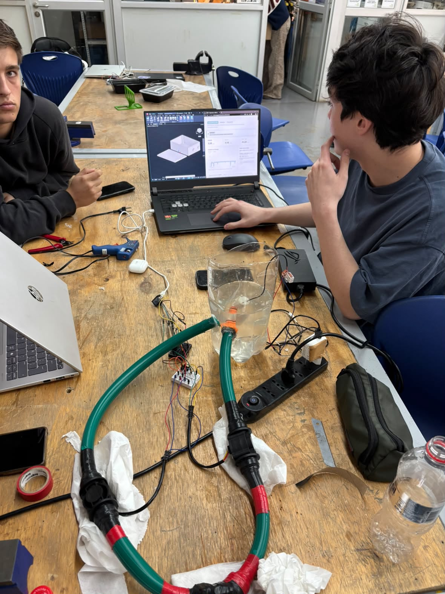
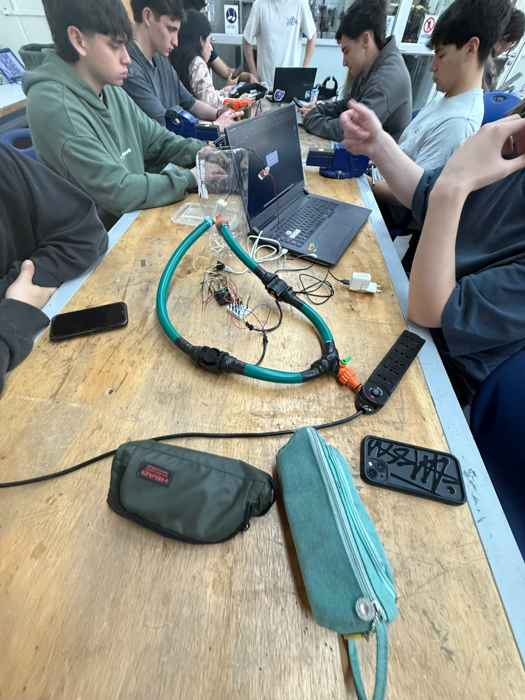

# Fotografías del Prototipo - Avance 2

El equipo aportó las siguientes fotografías, identificadas por el usuario como el montaje final. Los JPEG se conservan sin edición. La fecha del nombre de WhatsApp identifica el archivo recibido; no se usa como prueba independiente de la fecha de captura o de la evaluación.

## Montaje y monitor web

**Figura 1.** Se observan el recipiente con agua, mangueras, dos cuerpos de sensor, conexiones y electrónica sobre protoboards. En la pantalla del computador aparecen el modelo conceptual de caja y el monitor web con indicadores y gráfico. La foto documenta la presencia de la interfaz durante el montaje; su resolución no permite transcribir con fiabilidad todas las lecturas ni verificar el origen de cada valor.

## Vista general del banco

**Figura 2.** Vista complementaria del recorrido de mangueras, sensores, derivación con llave, depósito, protoboards y computador. La electrónica permanece expuesta sobre la mesa; el modelo de caja se mantiene como concepto, sin afirmar encapsulado físico terminado.

## Alcance de la evidencia

Las fotografías cubren la vista general del banco y muestran que el equipo disponía de un monitor web. No acreditan por sí solas cinco minutos de funcionamiento continuo, la secuencia de los tres LED, calibración absoluta o ahorro de agua. Falta una toma cercana legible de las conexiones críticas y, si se dispone de ellas, capturas de los tres estados y registros físicos continuos.

El [panel archivado](../../software/src/README.md) sigue identificado como una reconstrucción: la foto del monitor utilizado no reemplaza su HTML original. El [modelo CAD](../../diseno_3d/README.md) es evidencia del concepto, no de fabricación de la caja.
