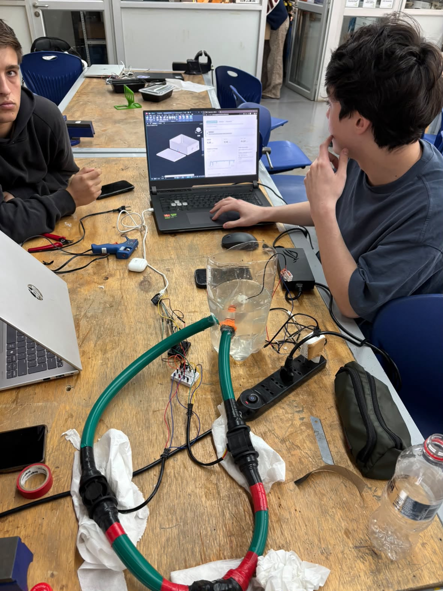
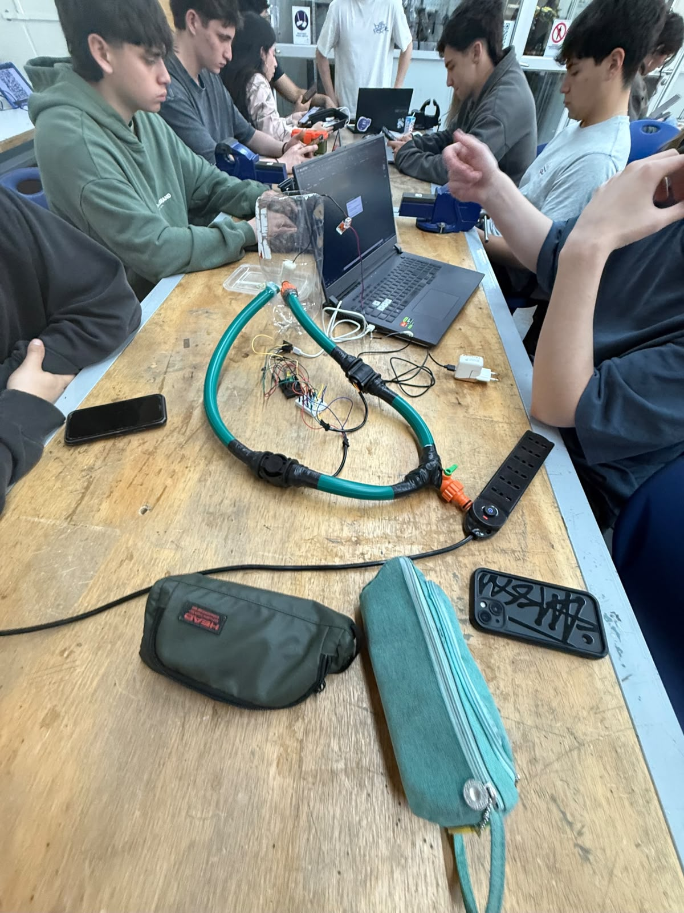
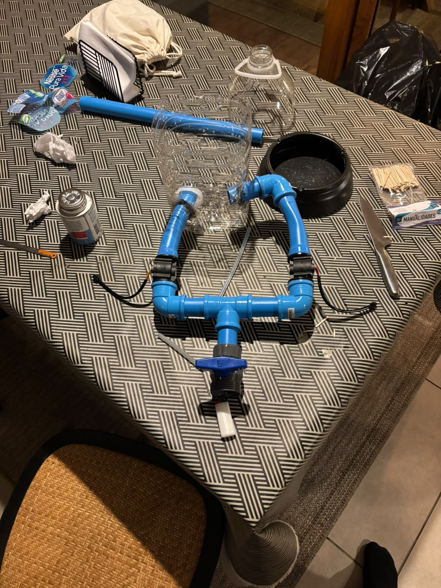
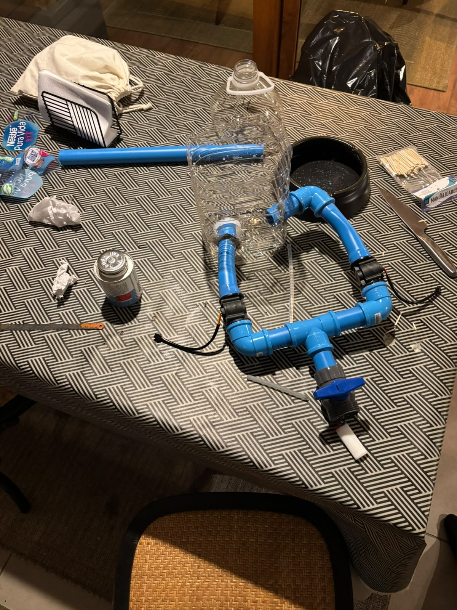
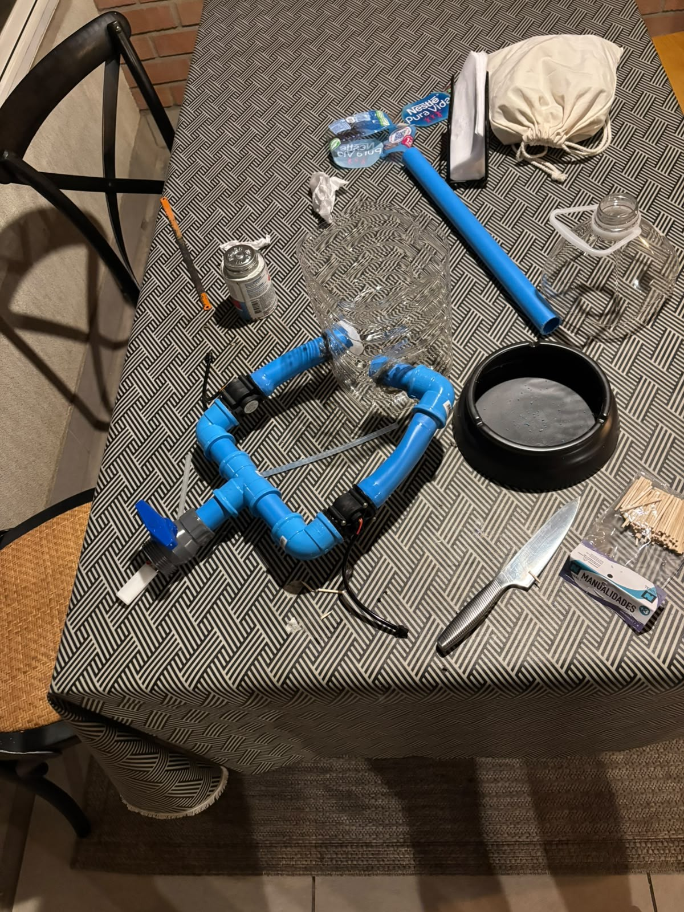
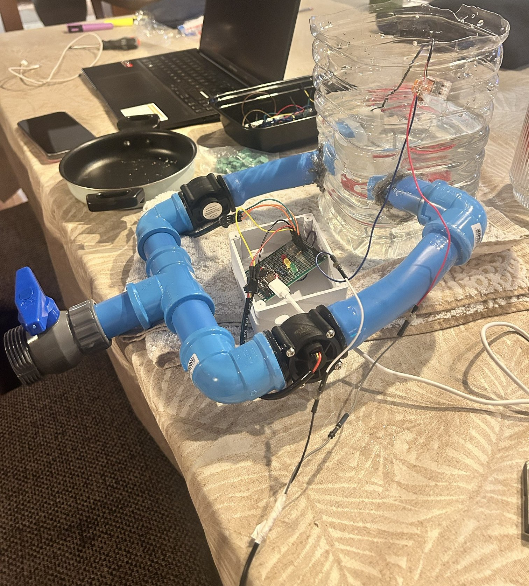
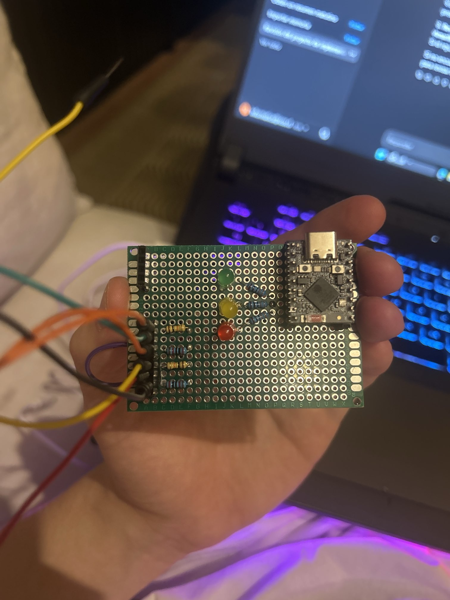
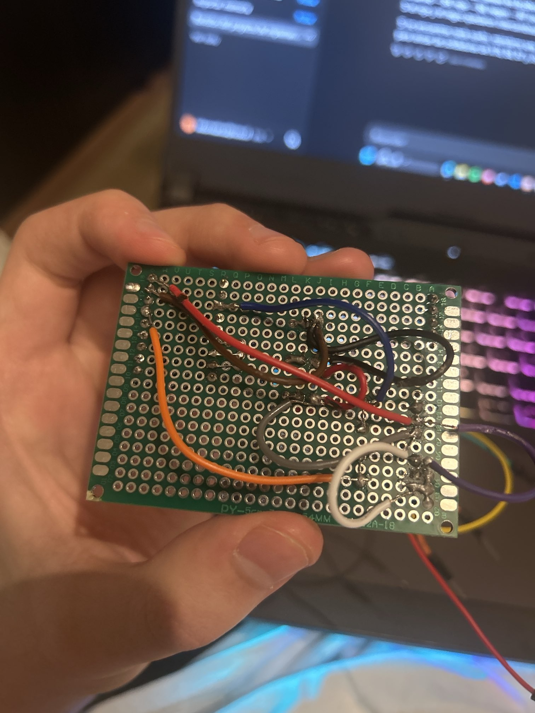
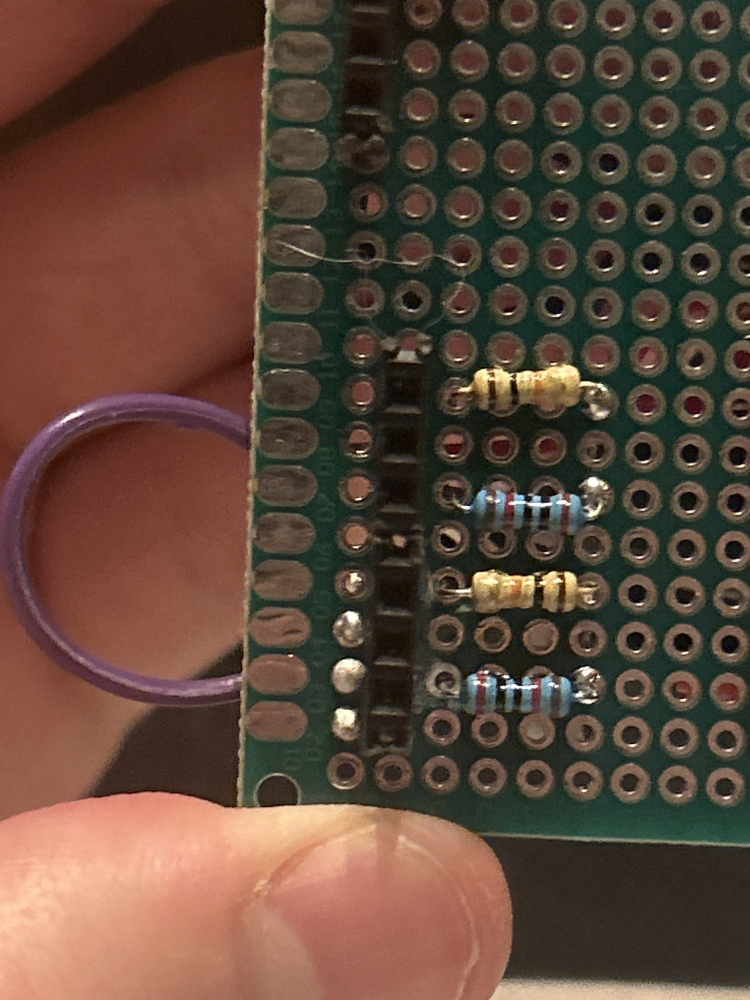

# Fotografías del Prototipo

El equipo aportó las siguientes fotografías, identificadas por el usuario como el montaje final. Los JPEG se conservan sin edición. La fecha del nombre de WhatsApp identifica el archivo recibido; no se usa como prueba independiente de la fecha de captura o de la evaluación.

## Montaje y monitor web

**Figura 1.** Se observan el recipiente con agua, mangueras, dos cuerpos de sensor, conexiones y electrónica sobre protoboards. En la pantalla del computador aparecen el modelo conceptual de caja y el monitor web con indicadores y gráfico. La foto documenta la presencia de la interfaz durante el montaje; su resolución no permite transcribir con fiabilidad todas las lecturas ni verificar el origen de cada valor.

## Vista general del banco

**Figura 2.** Vista complementaria del recorrido de mangueras, sensores, derivación con llave, depósito, protoboards y computador. La electrónica permanece expuesta sobre la mesa; el modelo de caja se mantiene como concepto, sin afirmar encapsulado físico terminado.

## Alcance de la evidencia

Las fotografías cubren la vista general del banco y muestran que el equipo disponía de un monitor web. No acreditan por sí solas cinco minutos de funcionamiento continuo, la secuencia de los tres LED, calibración absoluta o ahorro de agua. Falta una toma cercana legible de las conexiones críticas y, si se dispone de ellas, capturas de los tres estados y registros físicos continuos.

El [panel archivado](../../software/src/README.md) sigue identificado como una reconstrucción: la foto del monitor utilizado no reemplaza su HTML original. El [modelo CAD](../../diseno_3d/README.md) es evidencia del concepto, no de fabricación de la caja.

## Avance 3: banco de PVC 32 mm

El equipo aportó tres fotografías del nuevo banco hidráulico, tomadas el 22-11-2026. Se conservan en resolución completa.

**Figura 3.** Vista frontal: un FS400A en cada pierna del circuito y, al centro del tramo inferior, una tee con la válvula de bola que simula la fuga.

**Figura 4.** Vista diagonal: el circuito sale del estanque (bidón cortado) y vuelve a él.

**Figura 5.** Vista lateral del circuito cerrado de recirculación.

## Avance 3: electrónica soldada y sistema integrado (23-11-2026)

**Figura 6.** Sistema integrado: banco de PVC con los dos FS400A, la tee con válvula de fuga y la placa soldada dentro de una caja plástica de conexiones abierta. Los sensores llegan con conectores de 3 pines y la bomba se alimenta por separado (empalmes WAGO junto al estanque).

**Figura 7.** Cara de componentes: ESP32-S3 sobre cabezales hembra (se retira sin desoldar), tres LED con sus resistencias y, a la izquierda, el conector largo de los sensores con los dos divisores 10 kΩ / 20 kΩ.

**Figura 8.** Cara de soldaduras: cables aislados de alimentación, tierra y señal entre la ESP32, la línea de tierra de los LED y los conectores de los sensores.

**Figura 9.** Detalle del conector de sensores y los divisores (beige 10 kΩ, azul 20 kΩ) del sensor 1 (arriba) y del sensor 2 (abajo).
