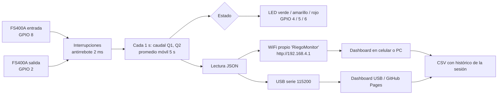
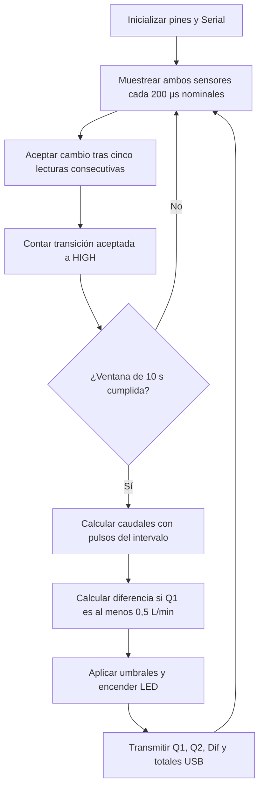

# Software - Avance 3

## Ciclo de datos

La ESP32-S3 **captura** los pulsos de los dos FS400A, **procesa** cada segundo el caudal de entrada y de salida, **decide** el estado del tramo (normal, advertencia, fuga o sin flujo), **actúa** sobre los LED y **publica** la lectura por dos vías: su propia red WiFi (dashboard en el navegador) y USB serie. El dashboard convierte las lecturas en indicadores para decidir si inspeccionar el tramo y las guarda en un CSV estructurado.



## Archivos

| Archivo | Qué es |
|---|---|
| [RiegoMonitor_WiFi.ino](src/RiegoMonitor_WiFi/RiegoMonitor_WiFi.ino) | **Firmware final.** Medición, LED, red WiFi propia, servidor web con el dashboard y salida USB |
| [Dashboard_USB.html](src/web/Dashboard_USB.html) | Dashboard que se conecta por cable USB (Web Serial, Chrome/Edge). Misma versión que [docs/index.html](../docs/index.html) para GitHub Pages |
| [dashboard_wifi_fuente.html](src/web/dashboard_wifi_fuente.html) | Fuente legible del dashboard que va incrustado en el firmware WiFi |
| [PruebaSensor.ino](src/PruebaSensor/PruebaSensor.ino) | Firmware de Avance 2 (USB, ventana de 10 s), conservado como antecedente |

## Parámetros del firmware final

| Parámetro | Valor | Justificación |
|---|---|---|
| Período de publicación | 1 s | El dashboard se actualiza en tiempo real; un cambio de caudal se ve en ~1 s |
| Ventana del estado | 5 s (promedio móvil) | A ~4 L/min un FS400A entrega pocos pulsos por segundo; promediar 5 s evita que el LED parpadee por un pulso de más o de menos. En Avance 2 la ventana fija de 10 s hacía la respuesta lenta |
| Antirrebote | 2 ms | Descarta pulsos espurios causados por el ruido del motor; a la frecuencia de trabajo los pulsos reales están separados por mucho más de 2 ms |
| K1 / K2 | 288 / 229 pulsos/L | Ajuste relativo de Avance 2. Se cambian en el código o por USB con el comando `K2=...` |
| Q_MIN | 0,5 L/min | Bajo este caudal de entrada no se evalúa: LED apagados, estado SIN_FLUJO |
| Umbrales | < 10 % normal · < 25 % advertencia · ≥ 25 % fuga | Iguales a Avance 2 |
| Pines | S1 → GPIO 8, S2 → GPIO 2, LED → GPIO 4/5/6 | La señal de S1 se movió de GPIO 1 a GPIO 8 durante el diagnóstico de la placa soldada (ver [testing](../testing/resultados_avance3.md)) |

Fórmulas: `Q = pulsos × 60 / K` [L/min]; `Dif = (Q1 − Q2) / Q1 × 100` [%] calculada con los promedios de 5 s.

## Formato de la lectura

Cada segundo la ESP32 genera una línea JSON. La entrega por USB y la responde en `GET /data`:

```json
{"seq":12,"t_ms":13136,"p1":18,"p2":15,"tot1":220,"tot2":181,"q1":3.750,"q2":3.930,
 "q1v":3.700,"q2v":3.600,"pct":2.70,"k1":288.0,"k2":229.0,"estado":"NORMAL","modo":"REAL"}
```

| Campo | Significado |
|---|---|
| `seq`, `t_ms` | Número de lectura y tiempo desde el arranque (ms) |
| `p1`, `p2` / `tot1`, `tot2` | Pulsos del último segundo / acumulados desde el arranque |
| `q1`, `q2` | Caudal del último segundo (L/min) |
| `q1v`, `q2v`, `pct` | Caudal promedio de 5 s y diferencia porcentual usados para el estado |
| `estado` | `SIN_FLUJO`, `NORMAL`, `ADVERTENCIA` o `FUGA` (coincide con los LED) |
| `modo` | `REAL` (sensores) o `DEMO` (escenario simulado para presentar) |

## Comandos

Por USB (una línea) o por WiFi (`GET /cmd?c=...`): `n`, `a`, `f` activan un escenario **simulado** (normal, advertencia, fuga) que mueve los LED y el dashboard, marcado `"modo":"DEMO"`; `x` vuelve a los sensores; `R` reinicia los totales; `K1=...` / `K2=...` cambian la calibración hasta el próximo reinicio.

## Información que genera el dashboard

| Indicador | Para qué decisión sirve |
|---|---|
| Estado con semáforo (igual a los LED) | Saber de inmediato si hay que revisar el tramo |
| Caudal de entrada y salida (L/min) | Confirmar que el riego está funcionando |
| Diferencia porcentual y L/min perdidos | Dimensionar la fuga |
| Agua perdida estimada en la sesión (L) | Cuantificar el desperdicio |
| Tiempo en cada estado y registro de eventos | Saber cuándo empezó una fuga y cuánto duró |
| Gráficos de caudal y de diferencia con umbrales | Ver tendencias y si la fuga empeora |

## Persistencia de los datos

Cada lectura queda en la sesión del navegador y se exporta con **Descargar CSV** (separador `;`, decimales con coma para Excel). Columnas: fecha y hora, origen (`ESP32_REAL`, `ESP32_DEMO_SIMULADO` o `SIMULADO`), caudales, diferencia, pulsos, volúmenes acumulados, K1, K2 y estado. Los CSV de las pruebas se guardan en [testing/datos](../testing/datos/README.md). No hay base de datos en la nube: enviar las lecturas a un servicio (por ejemplo Aiven PostgreSQL mediante un servidor en Railway) es el siguiente paso propuesto.

---

# Software - Avance 2 (antecedente)

## Arquitectura

El firmware lee dos FS400A por GPIO1/2, filtra cambios de nivel, cuenta flancos ascendentes y calcula caudales en ventanas nominales de 10 s. Compara la diferencia relativa, activa los LED por GPIO4/5/6 y transmite una línea USB serie a 115200 baudios. La comunicación actual no usa WiFi, Bluetooth, nube ni endpoints HTTP.



## Parámetros archivados

| Parámetro | Valor y alcance |
|---|---|
| K1 / K2 | 288 / 229 pulsos/L; ajuste relativo provisional |
| MUESTRA_US / ESTABLE | 200 µs / 5 lecturas; intento de muestreo por sondeo |
| VENTANA_MS | 10000 ms nominales |
| Q_MIN | 0,5 L/min; umbral de lógica, no rango validado |
| Amarillo / rojo | 10 % / 25 % |
| Serial | 115200 baudios |

Q = Δpulsos×60/(10×K). Si Q1≥0,5, Dif=(Q1−Q2)/Q1×100. Por debajo de Q_MIN los tres LED se apagan; con flujo, Dif<10 da verde, 10≤Dif<25 amarillo y Dif≥25 rojo. La diferencia negativa también queda verde en esta lógica. No hay detección específica de fallo de sensor.

Los totales son pulsos desde arranque, no litros; su razón acumulada no sustituye la razón entre incrementos del mismo intervalo. La ventana utiliza duración nominal, no tiempo efectivo. Ni los 200 µs ni los 10 s son una latencia experimental medida.

## Archivos y procedencia

El [índice de fuentes](src/README.md) diferencia el sketch histórico de GitHub, el código compartido directamente por el usuario como el utilizado por el equipo y el panel de consulta reconstruido. El código aportado coincide en instrucciones ejecutables con la reconstrucción previa (K1=288, K2=229, ventana 10 s); se corrigió únicamente el comentario desactualizado que decía 3 s. No se extrajo firmware de la placa ni se realizó una nueva prueba física. Las funciones y el uso se explican en el [manual](docs/README.md); las [dependencias](librerias/README.md) no incluyen librerías externas.
