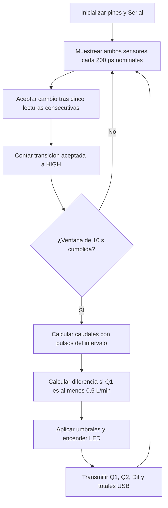

# Software - Avance 2

## Arquitectura

El firmware lee dos FS400A por GPIO1/2, filtra cambios de nivel, cuenta flancos ascendentes y calcula caudales en ventanas nominales de 10 s. Compara la diferencia relativa, activa los LED por GPIO4/5/6 y transmite una línea USB serie a 115200 baudios. La comunicación actual no usa WiFi, Bluetooth, nube ni endpoints HTTP.

## Parámetros archivados

| Parámetro | Valor y alcance |
|---|---|
| K1 / K2 | 288 / 229 pulsos/L; ajuste relativo provisional |
| MUESTRA_US / ESTABLE | 200 µs / 5 lecturas; intento de muestreo por sondeo |
| VENTANA_MS | 10000 ms nominales |
| Q_MIN | 0,5 L/min; umbral de lógica, no rango validado |
| Amarillo / rojo | 10 % / 25 % |
| Serial | 115200 baudios |

Q = Δpulsos×60/(10×K). Si Q1≥0,5, Dif=(Q1−Q2)/Q1×100. Por debajo de Q_MIN los tres LED se apagan; con flujo, Dif<10 da verde, 10≤Dif<25 amarillo y Dif≥25 rojo. La diferencia negativa también queda verde en esta lógica. No hay detección específica de fallo de sensor.

Los totales son pulsos desde arranque, no litros; su razón acumulada no sustituye la razón entre incrementos del mismo intervalo. La ventana utiliza duración nominal, no tiempo efectivo. Ni los 200 µs ni los 10 s son una latencia experimental medida.

## Archivos y procedencia

El [índice de fuentes](src/README.md) diferencia el sketch histórico de GitHub, el código compartido directamente por el usuario como el utilizado por el equipo y el panel de consulta reconstruido. El código aportado coincide en instrucciones ejecutables con la reconstrucción previa (K1=288, K2=229, ventana 10 s); se corrigió únicamente el comentario desactualizado que decía 3 s. No se extrajo firmware de la placa ni se realizó una nueva prueba física. Las funciones y el uso se explican en el [manual](docs/README.md); las [dependencias](librerias/README.md) no incluyen librerías externas.
